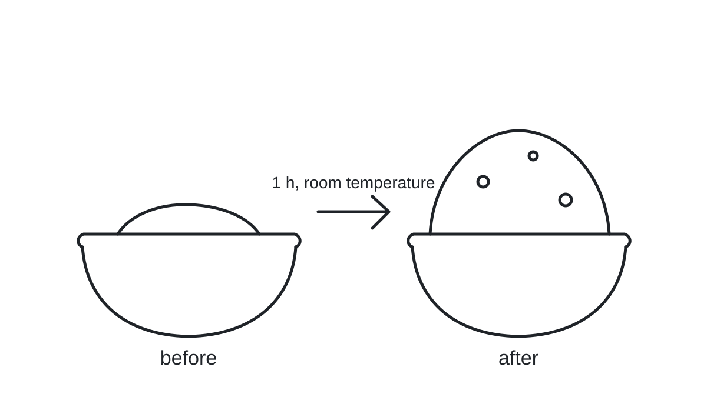

# Why Bread Rises

::: {#callout-ch01-01 .callout type=big-idea objective=obj-ch01-01}
Yeast eats sugar and breathes out gas. The gas is trapped by the dough, and trapped gas is what we call rising.
:::

::: {#callout-ch01-02 .callout type=must-know objective=obj-ch01-01}
Yeast converts sugars into carbon dioxide and ethanol. Gluten traps the carbon dioxide. Temperature sets the pace of both processes.
:::

A lump of dough left on the counter does something that looks almost alive. Over an hour it swells, softens, and smells faintly of beer. Nothing mystical happens inside that bowl, and once you can name the three actors involved you can steer the result with confidence.

::: {#callout-ch01-03 .callout type=why-it-matters objective=obj-ch01-02}
Most dense loaves and most collapsed loaves come from the same misunderstanding: treating rising as a fixed waiting time instead of a process you can watch and adjust.
:::

## Yeast, sugar, and gas

Bread yeast is a single-celled fungus. When it is warm and fed, it takes in simple sugars and releases carbon dioxide and a little alcohol. The alcohol mostly bakes off; the gas is what matters to the shape of the loaf.

::: {#callout-ch01-04 .callout type=definition objective=obj-ch01-01}
**Fermentation** is the conversion of sugars into gas and alcohol by yeast or bacteria without the need for oxygen.
:::

Flour contains starch and two proteins that join into gluten when they meet water and get kneaded. Gluten forms a stretchy network, and that network is what holds the bubbles of gas. Without gluten the gas would simply escape, which is why a flatbread made from rice flour stays flat no matter how long you wait.

::: {#callout-ch01-05 .callout type=key-principle objective=obj-ch01-01}
Rising needs two things at once: a gas source (active yeast with food) and a gas trap (a developed gluten network). Fixing one without the other changes nothing.
:::

::: {#callout-ch01-06 .callout type=tip objective=obj-ch01-02}
Dissolve the yeast in water that feels comfortably warm on the inside of your wrist. If it feels hot, it is too hot.
:::

{#fig-ch01-01 alt="Two bowls of dough drawn in ink, flat on the left and domed with bubbles on the right, joined by an arrow labelled one hour at room temperature"}

## Heat changes the pace

Yeast is slow when cold and fast when warm, up to a point. Around body temperature it works quickly. Well above that it slows again, and near the temperature of a hot cup of tea it dies.

::: {#callout-ch01-07 .callout type=warning objective=obj-ch01-02}
Water above about 50 °C kills yeast. If the dough does not rise at all, the water temperature is the first thing to check, before adding more yeast or more sugar.
:::

::: {#callout-ch01-08 .callout type=remember objective=obj-ch01-02}
Cold slows fermentation; it does not stop it. Dough left in a refrigerator overnight still rises, just slowly.
:::

::: {#callout-ch01-09 .callout type=evidence-note objective=obj-ch01-02}
Home-baking sources agree that fermentation roughly doubles in speed for every 10 °C increase between refrigerator temperature and body temperature. The exact rate depends on the yeast strain, the flour, and the amount of sugar, so treat the rule as a guide, not a timer.
:::

| Yeast form | How it is added | Typical first rise at 24 °C | Notes |
| --- | --- | --- | --- |
| Fresh (cake) | Crumbled into liquid | 60 to 90 minutes | Short shelf life |
| Active dry | Dissolved in warm water first | 75 to 100 minutes | Needs proofing |
| Instant | Mixed directly into flour | 60 to 80 minutes | Most forgiving |

Table: Three common forms of bread yeast and how they behave in a first rise.

::: {#callout-ch01-10 .callout type=worked-example objective=obj-ch01-02 title="Planning a loaf around a cold kitchen"}
Your kitchen is 18 °C and the recipe assumes 24 °C with a 75-minute first rise. Expect the dough to need roughly half again as long: plan for about 110 minutes, but judge by size, not by the clock. When the dough has doubled, it is ready, whatever the timer says.
:::

::: {#callout-ch01-11 .callout type=myth-fact objective=obj-ch01-01}
**Myth:** more sugar always means a faster, higher rise.
**Fact:** a small amount of sugar feeds yeast, but a lot of sugar pulls water out of the yeast cells and slows them down. Sweet doughs rise more slowly and usually need more yeast.
:::

::: {#callout-ch01-12 .callout type=limits objective=obj-ch01-02}
The doubling rule describes ordinary wheat doughs. Enriched doughs with butter and eggs, whole-grain doughs, and sourdough starters follow their own, slower curves.
:::

## Reading the dough

Recipes give times because times are easy to print. The dough itself gives better signals:

- It has roughly doubled in size.
- A floured finger pressed gently into it leaves a dent that springs back slowly.
- The surface shows a few small bubbles and a smooth, slightly domed top.

::: {#callout-ch01-13 .callout type=try-it objective=obj-ch01-02}
Divide one batch of dough into two bowls. Leave one on the counter and put the other in the refrigerator. Check both after an hour and again after three hours. You will see the temperature rule with your own eyes.
:::

::: {#callout-ch01-14 .callout type=case objective=obj-ch01-02}
A baker proofs dough on a sunny windowsill in a glass bowl. After forty minutes it has more than doubled and smells sharply sour. In the oven it collapses. The gas network was over-stretched: too warm, too fast, too long. The remedy is a cooler spot or a shorter rise, not less yeast.
:::

::: {#callout-ch01-15 .callout type=high-yield objective=obj-ch01-01}
Gas source plus gas trap. Any question about why a dough did or did not rise is answered by checking those two in turn.
:::

::: {#callout-ch01-16 .callout type=pearl objective=obj-ch01-02}
If a dough is late, warm the room rather than the dough. Direct heat on the bowl makes the outside race ahead of the centre.
:::

::: {#callout-ch01-17 .callout type=exam-trap objective=obj-ch01-01}
"Yeast needs oxygen to make the dough rise" is a tempting wrong answer. Fermentation runs without oxygen; that is what the word means.
:::

::: {#callout-ch01-18 .callout type=memory-aid objective=obj-ch01-01}
**F-T-T:** Food, Temperature, Trap. Yeast needs food and the right temperature; the dough needs a trap. The mnemonic lists the checks; it does not explain them, so read the section first.
:::

::: {#callout-ch01-19 .callout type=technical-corner objective=obj-ch01-01 title="Where the gas comes from"}
Yeast breaks glucose into two molecules of pyruvate, then removes a carbon from each as carbon dioxide and reduces what remains to ethanol. The pathway regenerates the carrier molecule the cell needs to keep going without oxygen. None of this is needed to bake well, but it explains both products at once.
:::

::: {#callout-ch01-20 .callout type=reflect objective=obj-ch01-02}
Which of these would you change first for a dough that is rising too slowly, and why: the room, the water, the amount of yeast, or the waiting time?
:::

::: {#callout-ch01-21 .callout type=quick-check objective=obj-ch01-01 item=item-ch01-001 reveal=chapter-end}
A dough made from rice flour and instant yeast is left in a warm kitchen for two hours and stays flat. Which actor is missing: the gas source, the gas trap, or the right temperature?
:::

## Recap

Yeast turns sugar into gas, gluten traps it, and temperature sets the pace. Judge a rise by size and texture, not by the clock, and when something goes wrong check the water temperature first.

::: {#callout-ch01-22 .callout type=answer-key for=ch-01}
**item-ch01-001.** The gas trap. Rice flour has no gluten-forming proteins, so the yeast produces gas that escapes instead of being held.
:::
