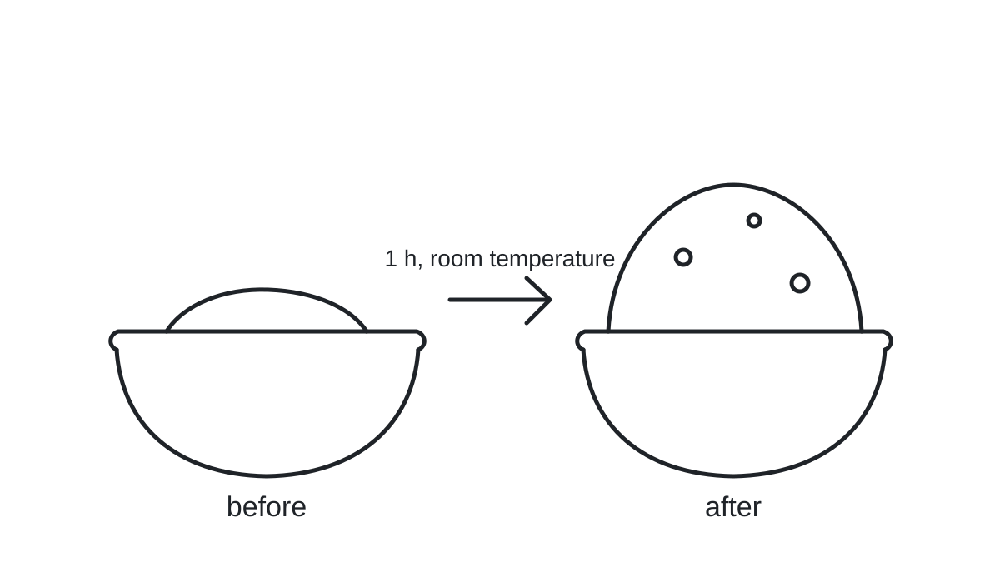

# Mengapa Roti Mengembang

::: {#callout-ch01-01 .callout type=big-idea objective=obj-ch01-01}
Ragi memakan gula dan mengeluarkan gas. Gas itu terperangkap di dalam adonan, dan gas yang terperangkap itulah yang kita sebut mengembang.
:::

::: {#callout-ch01-02 .callout type=must-know objective=obj-ch01-01}
Ragi mengubah gula menjadi karbon dioksida dan etanol. Gluten memerangkap karbon dioksida. Suhu menentukan kecepatan keduanya.
:::

Segumpal adonan yang dibiarkan di meja dapur melakukan sesuatu yang tampak hampir hidup. Dalam satu jam ia membesar, melunak, dan berbau samar seperti bir. Tidak ada yang gaib di dalam mangkuk itu, dan begitu Anda bisa menyebut tiga pelaku yang terlibat, Anda bisa mengarahkan hasilnya dengan percaya diri.

::: {#callout-ch01-03 .callout type=why-it-matters objective=obj-ch01-02}
Sebagian besar roti yang bantat dan sebagian besar roti yang ambruk berasal dari salah paham yang sama: memperlakukan pengembangan sebagai waktu tunggu yang tetap, bukan sebagai proses yang bisa diamati dan disesuaikan.
:::

## Ragi, gula, dan gas

Ragi roti adalah jamur bersel tunggal. Ketika hangat dan mendapat makanan, ia menyerap gula sederhana lalu melepaskan karbon dioksida dan sedikit alkohol. Alkoholnya sebagian besar menguap saat dipanggang; gasnya yang menentukan bentuk roti.

::: {#callout-ch01-04 .callout type=definition objective=obj-ch01-01}
**Fermentasi** adalah pengubahan gula menjadi gas dan alkohol oleh ragi atau bakteri tanpa memerlukan oksigen.
:::

Tepung mengandung pati dan dua protein yang bergabung menjadi gluten ketika bertemu air dan diuleni. Gluten membentuk jaringan yang lentur, dan jaringan itulah yang menahan gelembung gas. Tanpa gluten, gas akan lolos begitu saja; itulah sebabnya roti pipih dari tepung beras tetap pipih berapa lama pun ditunggu.

::: {#callout-ch01-05 .callout type=key-principle objective=obj-ch01-01}
Mengembang membutuhkan dua hal sekaligus: sumber gas (ragi aktif yang diberi makan) dan perangkap gas (jaringan gluten yang sudah terbentuk). Memperbaiki satu tanpa yang lain tidak mengubah apa pun.
:::

::: {#callout-ch01-06 .callout type=tip objective=obj-ch01-02}
Larutkan ragi dalam air yang terasa hangat nyaman di pergelangan tangan bagian dalam. Kalau terasa panas, berarti terlalu panas.
:::

{#fig-ch01-01 alt="Dua mangkuk adonan yang digambar dengan tinta, pipih di kiri dan membulat bergelembung di kanan, dihubungkan panah bertuliskan satu jam pada suhu ruang"}

## Panas mengubah kecepatan

Ragi lambat ketika dingin dan cepat ketika hangat, sampai batas tertentu. Di sekitar suhu tubuh ia bekerja cepat. Jauh di atas itu ia melambat lagi, dan di dekat suhu secangkir teh panas ia mati.

::: {#callout-ch01-07 .callout type=warning objective=obj-ch01-02}
Air di atas sekitar 50 °C mematikan ragi. Kalau adonan tidak mengembang sama sekali, suhu air adalah hal pertama yang diperiksa, sebelum menambah ragi atau gula.
:::

::: {#callout-ch01-08 .callout type=remember objective=obj-ch01-02}
Dingin memperlambat fermentasi; dingin tidak menghentikannya. Adonan yang disimpan di kulkas semalaman tetap mengembang, hanya perlahan.
:::

::: {#callout-ch01-09 .callout type=evidence-note objective=obj-ch01-02}
Sumber-sumber pembuatan roti rumahan sepakat bahwa fermentasi kira-kira dua kali lebih cepat untuk setiap kenaikan 10 °C antara suhu kulkas dan suhu tubuh. Laju persisnya bergantung pada galur ragi, tepung, dan jumlah gula, jadi perlakukan aturan ini sebagai panduan, bukan pengatur waktu.
:::

| Bentuk ragi | Cara menambahkan | Pengembangan pertama pada 24 °C | Catatan |
| --- | --- | --- | --- |
| Segar (padat) | Diremas ke dalam cairan | 60 sampai 90 menit | Umur simpan pendek |
| Kering aktif | Dilarutkan dulu dalam air hangat | 75 sampai 100 menit | Perlu diuji dulu |
| Instan | Dicampur langsung ke tepung | 60 sampai 80 menit | Paling toleran |

Table: Tiga bentuk ragi roti yang umum dan perilakunya pada pengembangan pertama.

::: {#callout-ch01-10 .callout type=worked-example objective=obj-ch01-02 title="Merencanakan roti di dapur yang dingin"}
Dapur Anda bersuhu 18 °C, sedangkan resep mengasumsikan 24 °C dengan pengembangan pertama 75 menit. Perkirakan adonan perlu kira-kira satu setengah kali lebih lama: rencanakan sekitar 110 menit, tetapi nilailah dari ukuran, bukan dari jam. Ketika adonan sudah dua kali lipat, ia siap, apa pun kata pengatur waktu.
:::

::: {#callout-ch01-11 .callout type=myth-fact objective=obj-ch01-01}
**Mitos:** gula yang lebih banyak selalu berarti pengembangan yang lebih cepat dan lebih tinggi.
**Fakta:** sedikit gula memberi makan ragi, tetapi gula yang banyak menarik air keluar dari sel ragi dan memperlambatnya. Adonan manis mengembang lebih lambat dan biasanya perlu lebih banyak ragi.
:::

::: {#callout-ch01-12 .callout type=limits objective=obj-ch01-02}
Aturan dua kali lipat ini menggambarkan adonan gandum biasa. Adonan kaya mentega dan telur, adonan gandum utuh, dan biang sourdough mengikuti kurvanya sendiri yang lebih lambat.
:::

## Membaca adonan

Resep memberi waktu karena waktu mudah dicetak. Adonan itu sendiri memberi sinyal yang lebih baik:

- Ukurannya kira-kira sudah dua kali lipat.
- Jari bertepung yang ditekan lembut meninggalkan lekukan yang kembali perlahan.
- Permukaannya memperlihatkan beberapa gelembung kecil dan puncak yang mulus dan sedikit membulat.

::: {#callout-ch01-13 .callout type=try-it objective=obj-ch01-02}
Bagi satu adonan ke dalam dua mangkuk. Biarkan satu di meja dan masukkan yang lain ke kulkas. Periksa keduanya setelah satu jam dan lagi setelah tiga jam. Anda akan melihat aturan suhu itu dengan mata sendiri.
:::

::: {#callout-ch01-14 .callout type=case objective=obj-ch01-02}
Seorang pembuat roti mengembangkan adonan di ambang jendela yang terkena sinar matahari dalam mangkuk kaca. Setelah empat puluh menit adonan sudah lebih dari dua kali lipat dan berbau asam tajam. Di oven, adonan itu ambruk. Jaringan gasnya terlalu teregang: terlalu hangat, terlalu cepat, terlalu lama. Obatnya tempat yang lebih sejuk atau waktu yang lebih singkat, bukan ragi yang lebih sedikit.
:::

::: {#callout-ch01-15 .callout type=high-yield objective=obj-ch01-01}
Sumber gas plus perangkap gas. Setiap pertanyaan tentang mengapa adonan mengembang atau tidak terjawab dengan memeriksa keduanya bergiliran.
:::

::: {#callout-ch01-16 .callout type=pearl objective=obj-ch01-02}
Kalau adonan terlambat, hangatkan ruangannya, bukan adonannya. Panas langsung pada mangkuk membuat bagian luar berlari mendahului bagian tengah.
:::

::: {#callout-ch01-17 .callout type=exam-trap objective=obj-ch01-01}
"Ragi membutuhkan oksigen untuk mengembangkan adonan" adalah jawaban salah yang menggoda. Fermentasi berjalan tanpa oksigen; itulah arti katanya.
:::

::: {#callout-ch01-18 .callout type=memory-aid objective=obj-ch01-01}
**M-S-P:** Makanan, Suhu, Perangkap. Ragi perlu makanan dan suhu yang tepat; adonan perlu perangkap. Jembatan keledai ini mendaftar pemeriksaannya, bukan menjelaskannya, jadi baca bagiannya dulu.
:::

::: {#callout-ch01-19 .callout type=technical-corner objective=obj-ch01-01 title="Dari mana gas itu berasal"}
Ragi memecah glukosa menjadi dua molekul piruvat, lalu melepaskan satu karbon dari masing-masing sebagai karbon dioksida dan mereduksi sisanya menjadi etanol. Jalur ini memulihkan molekul pembawa yang dibutuhkan sel agar terus bekerja tanpa oksigen. Tidak ada yang perlu dihafal untuk memanggang dengan baik, tetapi penjelasan ini menerangkan kedua produknya sekaligus.
:::

::: {#callout-ch01-20 .callout type=reflect objective=obj-ch01-02}
Mana yang akan Anda ubah lebih dulu untuk adonan yang mengembang terlalu lambat, dan mengapa: ruangan, air, jumlah ragi, atau waktu tunggu?
:::

::: {#callout-ch01-21 .callout type=quick-check objective=obj-ch01-01 item=item-ch01-001 reveal=chapter-end}
Adonan dari tepung beras dan ragi instan dibiarkan di dapur yang hangat selama dua jam dan tetap pipih. Pelaku mana yang hilang: sumber gas, perangkap gas, atau suhu yang tepat?
:::

## Rangkuman

Ragi mengubah gula menjadi gas, gluten memerangkapnya, dan suhu menentukan kecepatannya. Nilailah pengembangan dari ukuran dan tekstur, bukan dari jam, dan ketika ada yang salah, periksa suhu air lebih dulu.

::: {#callout-ch01-22 .callout type=answer-key for=ch-01}
- item-ch01-001: Perangkap gas. Tepung beras tidak memiliki protein pembentuk gluten, sehingga gas yang dihasilkan ragi lolos alih-alih tertahan.
:::
